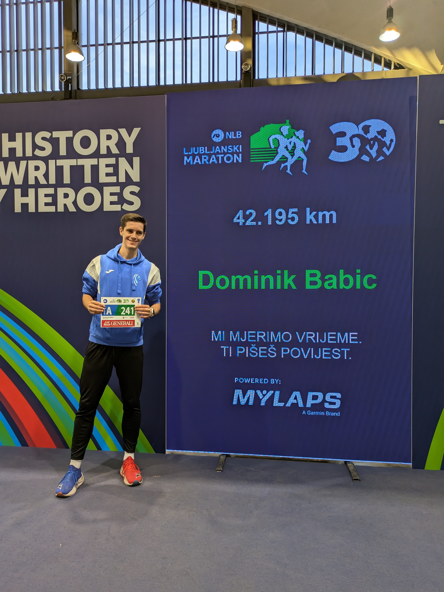

As I'm recovering back at my warn apartment after running my first ever marathon at the 30. Ljubljanski marathon, I decided to share my experience and maybe some advices for anyone who either already decided or is still deciding to take up a marathon.

Even tho I've been running for almost 10 years, most of that time was spent on training for sprint to middle distance races (400m, 800m and 1500m), so running anything above 10k was never even in consideration for a session. But for the last two years, I have taken upon myself to start doing some longer session and from there, my love for road races started.

##### Preparation 

So, once I registered to a marathon last year, I had no training plans for it, and to be quiet honest, neither did I have until last two weeks. I was training, but mostly for 1500m, 5k and 10k maybe, so I had some baseline with some long runs. There isn't one session that really helped me to get prepared for a marathon, since most of my sessions are focused on faster pace runs, but those still built my endurance, which I do see as a big plus. Also, long runs got me prepared for a controling a pace over a longer period.

Main things that I would say that matter during the preparation for a marathon is:

- Staying consistent.
- Pushing yourself to follow training, even when that feels like the last thing you want to do. Sure, make some compromises, but avoiding training should never be the first option.
- Enjoying runs and what it gives back. Enjoy the feeling of doing something, and beating yourself from yesterday.
- Staying patient when the results start to plateau.

I know these aren't training plans and some concrete training sessions, but I don't think my sessions are good examples for the marathon block. With that said, some of the free ways to get into running without the need to do the planning by yourself are running groups; there are a numerous running groups everywhere where people gather both to socialise and train (example Adidas Runners Zagreb has free training).

##### Before the race

Nutrition and hydration is important, so few days before the race, it is important to load yourself with carbohydrates. That means pasta, rice, pizza (but without anything spicy) is a big plus.

Also consider loading yourself with anything filled with carbohydrates for the race, which means either gels, or even something like gummy bears and similar. Since you'll be running for a longer period, you have to fuel yourself to sustain it.

Another important part are electrolytes, which will lower your chances to cramp up later on the run.

For instance, I bought a pack of gels from 4Endurance that contain each 45mg of carbohydrate and are filled with electrolytes. That way, I had covered both problems. Since I was planning on running under 3 hours, I packed 4 of those gels and took each one at the interval of 35 minutes.

##### The run

The most important rule you have to follow is: **Don't start out fast!** That should sound reasonable, but it still worth mentioning. Usually the common plan should be to run the first half around 5 seconds slower that the targeted pace, maybe even slower. The point is to get the feel of the run and start out without over-pushing yourself too much.

You will most certainly hit **"THE WALL"** - the part of the race that will test your grit and your limits (for me the 36th and 37th kilometres were it). Going out too fast will get you to that point sooner, and therefore even harder for the rest of the race. "The wall", as hard as it sounds, is just part of the race and gritting through it gets you to the last part of the race, for which there's always enough energy to finish.

And last advice I would share is: **Enjoy the crowd, enjoy the moment.** This is your moment, your race and in the end, you should be proud of finishing it and taking a part in it. No matter what happens, the best part should be the feeling of proud you have once you go through the finish line.

